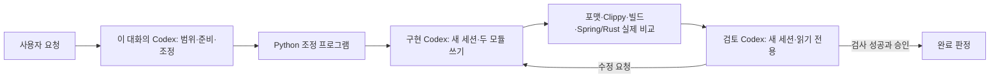

# 세 API 재현 샘플

뉴스 목록·상세와 포트폴리오 평가 계산의 실험용 Rust 서버다.
기존 `app/` 피드백 서버에 통합한 코드가 아니며, 전체 뉴스·전체 포트폴리오 기능 완료를 뜻하지 않는다.
HTTP/CSRF/DB 어댑터는 대화 Codex가 준비했고, 두 기능 모듈은 CLI 구현 에이전트가 작성한 뒤
검토 피드백과 대화 Codex의 추가 보완을 거쳤다. 상세 결과는 [실험 기록](../../runs/005-representative-sample.md)에 있다.

| 경로 | 동작 |
| --- | --- |
| GET `/api/news` | 발행 뉴스 목록, 카테고리·페이지·정렬 |
| GET `/api/news/{id}` | 발행 뉴스 상세, 초안/거절/없는 뉴스 차단 |
| POST `/api/portfolio/calculate` | 원화·달러 종목 평가, 가격 누락·혼합 날짜·정확한 십진수 계산 |

[샘플 계약](../../spec/representative-sample.md)과 [실험 기록](../../runs/005-representative-sample.md)을 함께 본다.
직접 작성한 크레이트는 unsafe를 금지하며 기존 Hyper·Tokio·serde_json·tokio-postgres를 사용한다.
새 외부 라이브러리를 다운로드하지 않고 기존 Cargo 캐시로 빌드했다.

## 재실행

프로젝트 루트에서:

```sh
python3 scripts/sample_features.py
```

구현 → 검사 → 별도 검토 → 필요 시 수정이 최대 3회 진행된다. 실제 Codex 로그인과 호출 가능 상태가 필요하다.
현재 저장된 코드를 시작점으로 사용하므로 재실행은 최초의 빈 구현에서 작성한 시간과 다르다.
`--stage implement`로 구현까지만 수행하고 출력된 실행 폴더를 `--resume <폴더>`로 이어갈 수도 있다.
`--from-run <실패 폴더>`는 이전 소스로 새로운 제한 실행을 시작하며 이전 결과를 덮지 않는다.
`blocked` 상태에서 자동으로 재개하거나 서비스 복구를 기다리는 스케줄러는 없다.

준비물: 원본 reference, 이전 Spring 비교로 생성한 `.local/spring-reference` jar와
`.local/comparison/source-snapshot.json`, 로컬 PostgreSQL·Rust·Codex CLI·의존성 캐시.
이 자료가 없으면 원본 비교 준비를 먼저 해야 한다. 샘플 실행기가 원본 jar를 새로 빌드하지는 않는다.
검증은 새 `daynomy_sample_*_test` DB에 원본 Flyway 스키마와 fixture를 넣고, Spring과 Rust를 실제로 시작한다.
시작한 서버와 DB 프로세스는 종료하고 DB 데이터는 실험 증거로 남긴다.

## AI 구조



- 실제 구현/검토는 동일 Codex CLI의 별도 세션이다. 다른 회사의 AI·자체 학습 모델을 구성한 것은 아니다.
- 두 역할은 순서대로 실행하며, 기능별 병렬 작업 큐·파일 충돌 조정·다중 공급자 fallback은 없다.
- Python과 테스트는 AI가 아니다. 이 대화의 Codex는 명세·기반 코드·검사기를 만들고, 막힌 부분도 보완했다.
- 모델명은 스크립트에 고정하지 않았다. CLI가 선택한 구체적 모델명을 증거 없이 추정하지 않는다.
  `--ignore-user-config`를 쓰므로 데스크톱 대화 설정과 같다고 가정하지 않는다.
- 구현 도구는 작업 폴더 쓰기만, 검토 도구는 읽기만 허용한다. 후보 서버도 OS 파일 읽기 전용이다.
  파일 읽기·서버 네트워크·DB 계정의 접근 범위 전체를 격리한 환경은 아니다.

## 한계

데이터 어댑터는 작은 fixture 테이블을 전수 로딩한다. 운영 쿼리·인덱스·성능 검증이 아니다.
환율은 캐시 fixture를 사용했고 실제 외부 호출·로그인·거래 원장·저장 변경 기능은 이번 샘플에 없다.
통과 사례 밖 모든 숫자 범위·JSON 자동 변환·HTTP 바인딩의 완전한 호환성까지 검증한 것은 아니다.
이 샘플의 수십 개 사례가 전체 서비스 구현 시간을 보장하지 않는다.

공식 실행 방식: [Codex 비대화형 실행](https://developers.openai.com/codex/noninteractive/).
